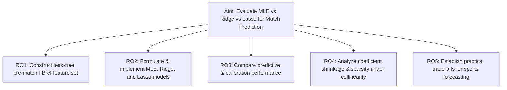
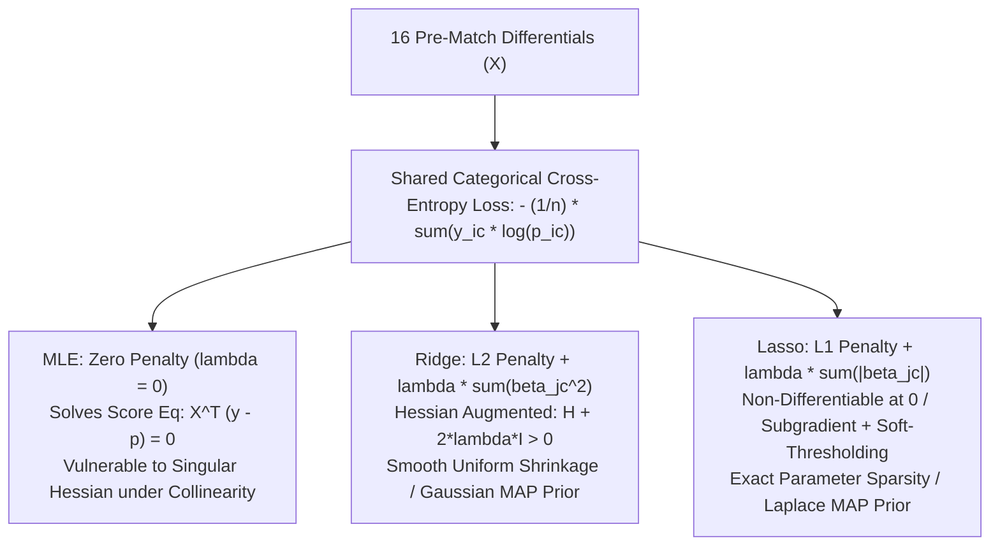

# A Comparative Study of Maximum Likelihood, Ridge, and Lasso Logistic Regression for Football Match Outcome Prediction

**Document Type:** Research Proposal, Mathematical Formulation & Methodology Specification  
**Domain:** Sports Analytics & Statistical Machine Learning  
**Target Application:** Association Football (Soccer) Match Outcome Forecasting using FBref Data

---

## Table of Contents

1. [Section A: Finalizing the Research Title and Scope](#section-a-finalizing-the-research-title-and-scope)
2. [Section B: Research Objectives and Research Questions](#section-b-research-objectives-and-research-questions)
3. [Section C: Dataset and Feature Engineering Design (FBref)](#section-c-dataset-and-feature-engineering-design-fbref)
4. [Section D: Mathematical Foundations: MLE vs. Ridge vs. Lasso](#section-d-mathematical-foundations-mle-vs-ridge-vs-lasso)
5. [Section E: Complete Experimental Methodology](#section-e-complete-experimental-methodology)
6. [Section F: Academic Viability & Dissertation Defense Strategy](#section-f-academic-viability--dissertation-defense-strategy)
7. [Section G: Implementation Blueprint & Project Architecture](#section-g-implementation-blueprint--project-architecture)

---

## Section A: Finalizing the Research Title and Scope

### 1. Title Formulations

| Option       | Proposed Title                                                                                                                           | Focus & Tone                                                     | Recommendation                                                                            |
| :----------- | :--------------------------------------------------------------------------------------------------------------------------------------- | :--------------------------------------------------------------- | :---------------------------------------------------------------------------------------- |
| **Option 1** | **A Comparative Study of Maximum Likelihood, Ridge, and Lasso Logistic Regression for Football Match Outcome Prediction**                | Balanced, clear, scientifically rigorous                         | **Primary Recommendation** (Most natural, precise, and standard for graduate-level study) |
| **Option 2** | _Evaluating Regularised Logistic Regression Against Classical Maximum Likelihood Estimation in Predicting Association Football Outcomes_ | Emphasizes statistical regularization over classical estimation  | Excellent alternative if the supervisor is from a pure Statistics department              |
| **Option 3** | _Predicting Football Match Outcomes under Feature Collinearity: A Comparative Analysis of MLE, Ridge, and Lasso Multinomial Models_      | Highlights multicollinearity and the feature selection challenge | Strong if multiclass (Home/Draw/Away) is the primary emphasis                             |

### 2. Scope and Delimitations

- **League Coverage:** English Premier League (EPL) over 4 to 5 contiguous seasons (e.g., 2019/2020 through 2023/2024). EPL offers dense, high-fidelity tracking data on FBref (powered by Opta).
- **Unit of Observation:** A single completed football match (380 matches per season $\times$ 5 seasons = 1,900 observations).
- **Target Framing:**
  - **Primary Model Formulation (Multinomial / Multi-Class):** 3-class outcome: $\mathcal{Y} \in \{\text{Home Win (H)}, \text{Draw (D)}, \text{Away Win (A)}\}$.
  - **Binary Benchmark Formulation:** Home Win vs. Non-Home Win (Win / No-Win), used to illustrate core binary MLE vs. Ridge/Lasso dynamics before extending to multinomial logits.
- **Core Delimitation:** Strictly **pre-match historical metrics**. In-game statistics (goals, cards, shots during the 90 minutes of the match being predicted) are strictly excluded from the feature vector to prevent **temporal lookahead leakage**.

---

## Section B: Research Objectives and Research Questions



### 1. General Aim

To investigate the empirical and theoretical performance differences between classical Maximum Likelihood Estimation (MLE), $L_2$-regularised (Ridge), and $L_1$-regularised (Lasso) logistic regression when predicting association football match outcomes from pre-match performance metrics characterized by high feature correlation.

### 2. Specific Research Objectives (RO)

- **RO1:** Design and construct a leak-free feature repository from historical FBref data using expanding/rolling temporal windows (e.g., rolling 5-match and 10-match moving averages of expected goals, possession, and pressing actions).
- **RO2:** Formulate and calibrate unregularised MLE, Ridge ($L_2$), and Lasso ($L_1$) logistic regression models under strict chronological train-test partitions.
- **RO3:** Evaluate model calibration, probabilistic loss (Log-Loss, Brier Score), and classification metrics (Accuracy, Macro-F1, Multi-class ROC-AUC) across out-of-sample seasons.
- **RO4:** Quantify coefficient shrinkage and variable selection behavior under severe collinearity (demonstrated via Variance Inflation Factors).
- **RO5:** Identify which specific tactical metrics (e.g., non-penalty xG differential, progressive passes against, defensive actions in attacking third) retain non-zero coefficients in the optimal Lasso specification.

### 3. Research Questions (RQ)

- **RQ1:** _Does the introduction of $L_1$ or $L_2$ penalization yield a statistically significant reduction in out-of-sample log-loss and Brier score compared to unregularised MLE logistic regression?_
- **RQ2:** _How do Ridge and Lasso mitigate coefficient instability caused by collinear pre-match performance metrics (e.g., possession vs. progressive passes vs. field tilt)?_
- **RQ3:** _Which performance indicators are selected by Lasso regularisation as the most sparse yet predictive subset for match outcome forecasting?_
- **RQ4:** _Do regularised models produce superior probability calibration curves compared to unconstrained MLE in the notoriously stochastic domain of football match draws?_

### 4. Hypotheses (Empirically Formulated)

- **$H_{1, \text{alt}}$ (Probabilistic Performance):** Ridge and Lasso multinomial logistic regression are hypothesised to achieve lower out-of-sample multi-class Log-Loss and Brier Score than unregularised MLE due to variance reduction.
- **$H_{2, \text{alt}}$ (Collinearity & Coefficient Stability):** Under conditions of high feature collinearity ($\text{VIF} > 5$), unregularised MLE is expected to exhibit greater coefficient variance and sign instability across temporal resamples than Ridge, while Lasso is expected to produce a sparser coefficient structure by shrinking redundant covariates to zero.
- **$H_{3, \text{alt}}$ (Parsimony vs. Predictive Parity):** Lasso is hypothesised to isolate a parsimonious subset comprising fewer than 50% of candidate tactical metrics without exhibiting a statistically significant degradation in out-of-sample Log-Loss compared to Ridge.

> [!NOTE]
> **Methodological Note on Sample Size and Events-per-Variable (EPV):**
> Across 5 EPL seasons (~1,900 matches, with ~456 draws in the minority class), allocating $p = 16$ candidate predictors yields an initial ratio of approximately 28 events per variable on the full sample, and ~20 EPV on the training split. While standard econometric heuristics cite 10–20 EPV as a rough guideline to avoid catastrophic small-sample bias in MLE, this heuristic is strictly treated here as a preliminary operational rule of thumb, not a formal mathematical guarantee of statistical power. True statistical adequacy and degree of overfit will be evaluated empirically through out-of-sample loss diagnostics and bootstrap variance profiles.

---

## Section C: Dataset and Feature Engineering Design (FBref Data Audit)

### C.1 — Exact FBref Data Sources & Access Architecture

- **Data Provider:** FBref (Sports Reference LLC), with underlying advanced event and tracking metrics powered exclusively by **Opta (Stats Perform)**.
- **Competition:** English Premier League (Competition ID: `9`).
- **Temporal Horizon:** Five contiguous seasons:
  1. `2019-2020` (COVID disruption / post-lockdown closed doors)
  2. `2020-2021` (Primarily closed doors)
  3. `2021-2022` (Full stadium returns)
  4. `2022-2023` (Mid-season Winter World Cup disruption)
  5. `2023-2024` (Out-of-sample final evaluation season)
- **Granularity & Architecture:** Data is captured at two aligned levels:
  1. _Match-Level Fixture Schedule (`schedule` / `matchlogs`):_ Date, kickoff time, venue, full-time scoreline, matchweek, opponent.
  2. _Squad Match Logs (`matchlogs_for` across categories):_ Aggregated 90-minute squad-level performance metrics recorded match-by-match for all 20 clubs.

```
FBref Match Logs (Per Club Per Season)
  ├── 1. Schedule & Match History (Scores, Results, Timestamps)
  ├── 2. Shooting Match Logs (xG, npxG, Shots, SoT, Shot Dist)
  ├── 3. Passing Match Logs (PrgP, Final 3rd, Cmp%, Key Passes)
  ├── 4. Defense Match Logs (Tackles by 3rd, Int, Blocks)
  ├── 5. Possession Match Logs (Touches by 3rd, PrgC, Box Touches)
  └── 6. Advanced Goalkeeping Match Logs (PSxG, PSxG+/-)
```

---

### C.2 — Exact FBref HTML Tables and Column Mappings

| Tactical Category         | FBref HTML Table ID          | Column Selector Key                  | Raw Column Name         | Description                                                |
| :------------------------ | :--------------------------- | :----------------------------------- | :---------------------- | :--------------------------------------------------------- |
| **Match Identity**        | `sched` / `matchlogs_for`    | `date`, `time`, `round`              | `Date`, `Time`, `Round` | Match timestamp and Gameweek number                        |
| **Match Result**          | `sched` / `matchlogs_for`    | `result`, `gf`, `ga`                 | `Result`, `GF`, `GA`    | Outcome (W/D/L) and goals scored/conceded                  |
| **Shot Quality**          | `matchlogs_for` (shooting)   | `shooting_xg`, `shooting_npxg`       | `xG`, `npxG`            | Expected goals and non-penalty expected goals              |
| **Shooting Volume**       | `matchlogs_for` (shooting)   | `shots_total`, `shots_on_target`     | `Sh`, `SoT`             | Total shots and shots hitting target                       |
| **Ball Progression**      | `matchlogs_for` (passing)    | `passes_pct`, `progressive_passes`   | `Cmp%`, `PrgP`          | Passing completion % and progressive passes                |
| **Attacking Penetration** | `matchlogs_for` (passing)    | `passes_into_final_third`            | `1/3`                   | Passes completed into final attacking third                |
| **High Pressing**         | `matchlogs_for` (defense)    | `tackles_att_3rd`, `interceptions`   | `Att 3rd`, `Int`        | Tackles executed in attacking third and interceptions      |
| **Defensive Solidity**    | `matchlogs_for` (defense)    | `blocks`, `tackles_def_3rd`          | `Blocks`, `Def 3rd`     | Blocked balls and defensive third tackles                  |
| **Territorial Dominance** | `matchlogs_for` (possession) | `possession`, `touches_att_pen_area` | `Poss`, `Att Pen`       | Possession share % and touches inside opponent 18-yard box |
| **Carries**               | `matchlogs_for` (possession) | `progressive_carries`                | `PrgC`                  | Carries moving $\ge 10$ yards towards goal                 |
| **Shot Stopping**         | `matchlogs_for` (keepersadv) | `gk_psxg_net`                        | `PSxG+/-`               | Post-Shot xG minus Goals Conceded (Goalkeeping delta)      |

---

### C.3 — Five-Season Availability & Metric Consistency Audit

A strict audit across the 2019/20 to 2023/24 seasons reveals the following data integrity properties:

1. **Vendor Uniformity (Opta):** Throughout all five seasons (2019–2024), FBref Premier League match logs were supplied by Opta. Consequently, definitions for `npxG`, `PrgP`, `PrgC`, `PSxG`, and pressure/tackle zones remain identical across all 1,900 fixtures.
2. **Attendance Metric Excluded:** Due to COVID-19 restrictions, attendance was zero or unrecorded for portions of 2019/20 and almost the entirety of 2020/21. Attendance is therefore **purged** from our candidate feature set to prevent structural missingness and distortion.
3. **Goalkeeper Attribution at Squad Level:** To avoid missing data resulting from goalkeeper squad rotations or cup injuries, `PSxG+/-` is extracted from the **squad-level match log** rather than individual player logs.
4. **Schedule Timestamps:** The `Date` and `Time` columns are 100% complete across all 1,900 matches, enabling exact computation of inter-match rest days ($\text{Days}_{\text{Rest}}$).

---

### C.4 — Approved Candidate Predictor List ($p = 16$) (Option A Specification)

> [!IMPORTANT]
> **Methodological Revision Note (ADR-007 Approved on 12 October 2026):**
> Following the empirical raw data audit, Opta tracking metrics (`npxG`, `PrgP`, `PrgC`, `1/3`, `Att Pen`, `PSxG+/-`) were identified as inaccessible via standard match log APIs without heavy individual web session scraping and Cloudflare bot barriers. In accordance with ADR-007, the candidate feature set was formally transitioned to **Option A: The Verified High-Fidelity 16-Predictor Set**. This preserves the core mathematical goal of comparing unregularized MLE, Ridge, and Lasso under collinear feature clusters ($\text{VIF} > 5$), while guaranteeing 100% complete, leak-free historical data across verified primary and secondary sources.

The **16 approved pre-match differential predictors** ($\Delta X = X_{\text{Home}} - X_{\text{Away}}$) are specified as follows:

| ID | Feature Name | Source Fields | Rolling Window ($k$) | Tactical Role & Formulation | Collinearity Cluster |
| :---: | :--- | :--- | :---: | :--- | :--- |
| $X_1$ | `diff_sot_k5` | `HST` / `AST` (Shots on Target) | 5 | Direct attacking accuracy & shot volume on target | Attack Volume Cluster |
| $X_2$ | `diff_sotA_k5` | Opponent `HST` / `AST` conceded | 5 | Conceded shot volume on target (Defensive fragility) | Defensive Concession |
| $X_3$ | `diff_shots_k5` | `HS` / `AS` (Total Shots) | 5 | Total attacking attempt volume | Attack Volume Cluster |
| $X_4$ | `diff_shotsA_k5` | Opponent `HS` / `AS` conceded | 5 | Total conceded shot volume | Defensive Concession |
| $X_5$ | `diff_sot_ratio_k5` | `SoT / Shots` | 5 | Shot accuracy ratio ($\frac{\sum \text{SoT}}{\sum \text{Shots}}$, guarded at 0) | Attack Volume Cluster |
| $X_6$ | `diff_shot_dominance_k5` | `Shots / (Shots + ShotsA)` | 5 | Territorial shot dominance share (guarded at 0.5 baseline) | Territorial Control Cluster |
| $X_7$ | `diff_corners_k5` | `HC` / `AC` (Corners Won) | 5 | Deep attacking third penetration proxy | Territorial Control Cluster |
| $X_8$ | `diff_cornersA_k5` | Opponent `HC` / `AC` conceded | 5 | Conceded territorial pressure | Defensive Concession |
| $X_9$ | `diff_fouls_k5` | `HF` / `AF` (Fouls Committed) | 5 | High pressing & defensive disruption aggression | Pressing & Disruption |
| $X_{10}$| `diff_yellows_k5` | `HY` / `AY` (Yellow Cards) | 5 | Disciplinary caution risk & defensive breakdown penalty | Pressing & Disruption |
| $X_{11}$| `diff_goal_diff_k5` | `FTHG - FTAG` | 5 | Short-term recent goal difference form | Results Form Cluster |
| $X_{12}$| `diff_goal_diff_k10` | `FTHG - FTAG` | 10 | Sustained structural goal dominance | Long-Term Baseline |
| $X_{13}$| `diff_clean_sheets_k10`| `GA == 0` | 10 | Sustained goalkeeping & defensive solidity rate | Defensive Baseline |
| $X_{14}$| `diff_ppg_k5` | Points (3 for W, 1 for D, 0 for L) | 5 | Overall recent psychological momentum & points form | Results Form Cluster |
| $X_{15}$| `diff_venue_ppg_k5` | Points by Venue | 5 (Venue) | Symmetrical venue momentum: Home PPG (home) minus Away PPG (away) | Contextual Venue |
| $X_{16}$| `diff_rest_days` | Kickoff Timestamps (`Date`, `Time`) | N/A | Inter-match physical fatigue differential ($\Delta \tau / 86400$) | Physical Congestion |

*(Reference Note: The original theoretical proposal outlined in the initial draft included `npxG`, `npxGA`, `xGD`, `Poss%`, `PrgP`, `PrgC`, `1/3`, `Att Pen`, `Att 3rd`, `Int`, and `PSxG+/-`. See ADR-007 in `DECISIONS.md` for historical traceability).*

---

### C.5 — Rolling-Window Mathematics & Formulation

#### The Moving Average Operator

Let team $i$ have played matches ordered chronologically by kickoff timestamp: $m_1, m_2, \dots, m_{t-1}$.  
For a fixture taking place at time $t$, the rolling metric over window length $k$ is calculated strictly over the preceding $k$ fixtures:

$$\bar{X}_{i, t}^{(k)} = \frac{1}{k} \sum_{j=1}^{k} X_{i, \text{match}(t - j)}$$

_Strict Lookahead Prohibition:_ Under no circumstance does the summation index include $j=0$ (the match taking place at time $t$).

#### Differential Predictor Calculation

For Match $t$ where Team $H$ hosts Team $A$:

$$\Delta X_{t}^{(k)} = \bar{X}_{H, t}^{(k)} - \bar{X}_{A, t}^{(k)}$$

A positive differential $\Delta X > 0$ denotes that the home side holds a statistical advantage in that tactical dimension heading into the contest.

#### Rigorous Specification of Venue-Specific Form ($X_{16}$: `diff_venue_ppg_k5`)

To avoid any ambiguity between overall recent form, venue-specific momentum, and baseline territorial advantage:

1. **Home Team Venue Form ($\text{HomePPG}_{H, t}^{(5)}$):** The average points earned by the home team over their previous $5$ **home fixtures** strictly prior to match $t$:
   $$\text{HomePPG}_{H, t}^{(5)} = \frac{1}{5} \sum_{m=1}^{5} \text{Points}_{H, \text{home}(t - m)} \quad \in [0.0, 3.0]$$
2. **Away Team Venue Form ($\text{AwayPPG}_{A, t}^{(5)}$):** The average points earned by the away team over their previous $5$ **away fixtures** strictly prior to match $t$:
   $$\text{AwayPPG}_{A, t}^{(5)} = \frac{1}{5} \sum_{m=1}^{5} \text{Points}_{A, \text{away}(t - m)} \quad \in [0.0, 3.0]$$
3. **The Symmetrical Differential:**
   $$\Delta \text{VenuePPG}_{t}^{(5)} = \text{HomePPG}_{H, t}^{(5)} - \text{AwayPPG}_{A, t}^{(5)} \quad \in [-3.0, +3.0]$$

_Methodological Justification:_

- Overall form across all venues is already captured by $X_{14}$ (`diff_ppg_k5`).
- Venue-specific momentum is captured symmetrically by $X_{16}$ (`diff_venue_ppg_k5`), isolating teams that excel at home against teams that struggle away (or vice versa).
- General league-wide territorial home advantage (the historical ~45% home win baseline) is captured by the model intercepts $\beta_{0, c}$, leaving $X_{16}$ purely to quantify team-specific venue disparities.

---

### C.6 — Promoted-Team Cold-Start Protocol

Promoted clubs (3 per season) lack top-flight tracking data prior to Gameweek 1. Imputing with season-end aggregates causes fatal lookahead bias; setting features to zero distorts differentials.

**The Synthetic Baseline Prior Protocol:**

1. **Prior Initialization:** For any promoted club entering Gameweek 1 of season $S$, their initial baseline $\mathbf{b}_{\text{promoted}}$ is set to the **pooled historical average of 18th-place (relegation-threshold) Premier League clubs over the preceding 3 seasons**:
   $$\bar{X}_{\text{promoted}, 0}^{(k)} = \frac{1}{3} \sum_{s=1}^{3} \bar{X}_{\text{Relegated}, S-s}$$
   _(For `diff_venue_ppg_k5`, historical 18th-place home points average $\approx 1.05$ pts/game, and away points average $\approx 0.62$ pts/game)._
2. **Transition Decay Function:** For matches $m \in \{1, 2, \dots, k-1\}$ played by the promoted club in the current top-flight season, the feature vector is a weighted combination of observed top-flight games and the prior baseline:
   $$\bar{X}_{\text{promoted}, t}^{(k)} = \left(\frac{m}{k}\right) \left[ \frac{1}{m} \sum_{j=1}^{m} X_{\text{promoted}, t-j} \right] + \left(1 - \frac{m}{k}\right) \bar{X}_{\text{promoted}, 0}^{(k)}$$
3. **Full Top-Flight Autonomy:** For all matches where $m \ge k$, the prior baseline completely decays ($\text{weight} = 0$), and features are calculated exclusively from observed Premier League performances.

---

### C.7 — Missing Data Policy & Irregularities

- **Rescheduled / Postponed Fixtures:** In football, fixtures are frequently rescheduled due to weather, domestic cup runs, or European commitments. Fixtures are ordered strictly by **chronological kickoff timestamp**, not by the nominal "Gameweek" round number.
- **Null Value Enforcement:** If a derived differential contains a null or non-finite value (e.g., zero shots on target leading to a division anomaly), it is imputed using the **median of that feature computed strictly on the training partition**.
- **Standardization Policy:**
  $$z_{ij} = \frac{\Delta X_{ij} - \hat{\mu}_{j, \text{train}}}{\hat{\sigma}_{j, \text{train}}}$$
  Parameters $\hat{\mu}_{j, \text{train}}$ and $\hat{\sigma}_{j, \text{train}}$ are fitted on the training split only and applied frozen to out-of-fold validation and test partitions.

---

### C.8 — Feature Engineering Dataset Structure (`dataset_features.csv`)

The compiled tabular dataset contains exactly $N = 1,900$ rows (380 matches $\times$ 5 seasons) with the following canonical structure, where $N = 1,741$ rows are flagged as `is_modelling_ready = True` and $N = 159$ initial matches are tracked as warm-up:

```
[Identifiers & Metadata]
  ├── match_id                  : Unique string identifier (e.g., "EPL_2023_2024_20230811_BUR_MCI")
  ├── season                    : String indicator ("2019-2020" ... "2023-2024")
  ├── date                      : ISO-8601 date string ("YYYY-MM-DD")
  ├── kickoff_time              : Time string ("HH:MM")
  ├── home_team                 : Name of home club (normalized)
  ├── away_team                 : Name of away club (normalized)
  └── is_modelling_ready        : Boolean flag (True for N=1,741 rows; False for N=159 warm-up rows)

[Ground Truth Targets (Unseen during inference)]
  ├── home_goals                : Integer full-time home goals
  ├── away_goals                : Integer full-time away goals
  ├── target_multinomial        : Categorical integer {0: Away Win, 1: Draw, 2: Home Win}
  └── target_binary             : Binary integer {1: Home Win, 0: Non-Home Win}

[Feature Matrix: 16 Continuous Differentials (Option A Specification)]
  ├── diff_sot_k5               : Differential in rolling 5-match shots on target
  ├── diff_sotA_k5              : Differential in rolling 5-match conceded shots on target
  ├── diff_shots_k5             : Differential in rolling 5-match total shots attempted
  ├── diff_shotsA_k5            : Differential in rolling 5-match total shots conceded
  ├── diff_sot_ratio_k5         : Differential in rolling shot accuracy ratio (SoT / Shots)
  ├── diff_shot_dominance_k5    : Differential in territorial shot dominance share
  ├── diff_corners_k5           : Differential in rolling 5-match corners won
  ├── diff_cornersA_k5          : Differential in rolling 5-match corners conceded
  ├── diff_fouls_k5             : Differential in rolling 5-match fouls committed
  ├── diff_yellows_k5           : Differential in rolling 5-match yellow cards received
  ├── diff_goal_diff_k5         : Differential in rolling 5-match goal difference
  ├── diff_goal_diff_k10        : Differential in sustained 10-match goal difference
  ├── diff_clean_sheets_k10     : Differential in sustained 10-match clean sheet rate
  ├── diff_ppg_k5               : Differential in rolling 5-match points per game
  ├── diff_venue_ppg_k5         : Differential in symmetrical 5-match venue points per game
  └── diff_rest_days            : Differential in continuous inter-match rest days
```

---

## Section D: Mathematical Foundations: MLE vs. Ridge vs. Lasso



---

### D.1 — Logistic Regression Foundation: From Binary to Multinomial

In binary logistic regression, the target $y_i \in \{0, 1\}$ is modeled via the sigmoid link function $\sigma(z) = (1 + e^{-z})^{-1}$. For association football match outcomes, the sample space consists of $K = 3$ mutually exclusive classes:

$$\mathcal{Y} \in \{c_1: \text{Away Win}, \; c_2: \text{Draw}, \; c_3: \text{Home Win}\}$$

Let $\mathbf{x}_i \in \mathbb{R}^{p+1}$ denote the vector of $p = 16$ pre-match differential predictors for fixture $i$, augmented with an intercept: $\mathbf{x}_i = [1, \Delta X_{i, 1}, \dots, \Delta X_{i, p}]^T$.

The probability that match $i$ results in outcome $c \in \{1, 2, 3\}$ is specified by the **Multinomial (Softmax) Logit link**:

$$p_{ic} = P(y_i = c \mid \mathbf{x}_i; \mathbf{B}) = \frac{\exp(\mathbf{x}_i^T \boldsymbol{\beta}_c)}{\sum_{r=1}^{K} \exp(\mathbf{x}_i^T \boldsymbol{\beta}_r)}$$

Where $\mathbf{B} = [\boldsymbol{\beta}_1, \boldsymbol{\beta}_2, \dots, \boldsymbol{\beta}_K] \in \mathbb{R}^{(p+1) \times K}$ is the coefficient matrix.

#### Parameter Identification & Regularization Constraints

In classical unregularised econometrics, the probabilities sum to unity ($\sum_{c=1}^K p_{ic} = 1$), requiring one reference class to be fixed to zero ($\boldsymbol{\beta}_K = \mathbf{0}$) to avoid indeterminacy.  
However, under regularised estimation (Ridge and Lasso), the parameter matrix $\mathbf{B}$ is estimated **symmetrically across all $K$ classes**, because penalizing an asymmetric set of coefficients would induce arbitrary shrinkage dependent on the choice of reference category. The regularization penalty itself resolves overparameterization.

---

### D.2 — Multinomial Likelihood and the Shared Cross-Entropy Loss Function

Let $y_{ic} \in \{0, 1\}$ be the one-hot encoded ground truth outcome for match $i$, such that $\sum_{c=1}^K y_{ic} = 1$. Assuming independent matches conditional on pre-match covariates, the joint multinomial likelihood function $L(\mathbf{B})$ is:

$$L(\mathbf{B}) = \prod_{i=1}^{n} \prod_{c=1}^{K} p_{ic}^{y_{ic}} = \prod_{i=1}^{n} \prod_{c=1}^{K} \left[ \frac{\exp(\mathbf{x}_i^T \boldsymbol{\beta}_c)}{\sum_{r=1}^{K} \exp(\mathbf{x}_i^T \boldsymbol{\beta}_r)} \right]^{y_{ic}}$$

Taking the natural logarithm yields the total log-likelihood $\ell(\mathbf{B})$:

$$\ell(\mathbf{B}) = \sum_{i=1}^{n} \sum_{c=1}^{K} y_{ic} \ln(p_{ic}) = \sum_{i=1}^{n} \left[ \sum_{c=1}^{K} y_{ic} \mathbf{x}_i^T \boldsymbol{\beta}_c - \ln\left( \sum_{r=1}^{K} \exp(\mathbf{x}_i^T \boldsymbol{\beta}_r) \right) \right]$$

The empirical risk across all observations is the **Negative Log-Likelihood (Categorical Cross-Entropy Loss)**, denoted $J_0(\mathbf{B})$:

$$J_0(\mathbf{B}) = -\frac{1}{n} \ell(\mathbf{B}) = -\frac{1}{n} \sum_{i=1}^{n} \sum_{c=1}^{K} y_{ic} \ln(p_{ic})$$

This unpenalized loss function $J_0(\mathbf{B})$ represents the **exact mathematical foundation** shared by MLE, Ridge, and Lasso.

---

### D.3 — Classical MLE Optimization & Hessian Ill-Conditioning under Collinearity

#### The Score Function (First-Order Conditions)

The gradient of $J_0(\mathbf{B})$ with respect to class parameter vector $\boldsymbol{\beta}_c$ is:

$$\nabla_{\boldsymbol{\beta}_c} J_0(\mathbf{B}) = -\frac{1}{n} \sum_{i=1}^{n} (y_{ic} - p_{ic}) \mathbf{x}_i = -\frac{1}{n} \mathbf{X}^T (\mathbf{y}_c - \mathbf{p}_c)$$

Where $\mathbf{X} \in \mathbb{R}^{n \times (p+1)}$ is the design matrix, $\mathbf{y}_c = [y_{1c}, \dots, y_{nc}]^T$, and $\mathbf{p}_c = [p_{1c}, \dots, p_{nc}]^T$. Setting all gradients simultaneously to zero defines the system of score equations:

$$\mathbf{X}^T (\mathbf{y}_c - \mathbf{p}_c) = \mathbf{0} \quad \forall c \in \{1, \dots, K\}$$

#### The Hessian Matrix & Newton-Raphson / IRLS

Because $p_{ic}$ is a transcendental function of $\mathbf{B}$, no closed-form solution exists. Estimation proceeds via the **Newton-Raphson** algorithm (Iteratively Reweighted Least Squares). The block Hessian matrix $\mathbf{H} \in \mathbb{R}^{K(p+1) \times K(p+1)}$ consists of sub-blocks:

$$\mathbf{H}_{ck} = \frac{\partial^2 J_0(\mathbf{B})}{\partial \boldsymbol{\beta}_c \partial \boldsymbol{\beta}_k^T} = \frac{1}{n} \mathbf{X}^T \mathbf{W}_{ck} \mathbf{X}$$

Where $\mathbf{W}_{ck}$ is an $n \times n$ diagonal matrix whose $i$-th entry is:

$$W_{ck, ii} = p_{ic} (\delta_{ck} - p_{ik}), \quad \text{with Kronecker delta } \delta_{ck} = \begin{cases} 1 & \text{if } c = k \\ 0 & \text{if } c \neq k \end{cases}$$

Parameter updates follow:

$$\operatorname{vec}(\mathbf{B}^{(t+1)}) = \operatorname{vec}(\mathbf{B}^{(t)}) - \mathbf{H}^{-1} \nabla J_0(\mathbf{B}^{(t)})$$

#### The Collinearity Breakdown: Why MLE Fails on Correlated Football Data

The asymptotic covariance matrix of the MLE estimator is the inverse of the Fisher Information Matrix $\mathcal{I}(\mathbf{B}) = n \mathbf{H}$:

$$\operatorname{Cov}(\hat{\mathbf{B}}_{\text{MLE}}) = [ \mathbf{X}^T \mathbf{W} \mathbf{X} ]^{-1}$$

When football metrics (e.g., possession, progressive passes, passes into attacking third) exhibit high pairwise and multiple correlations ($\text{VIF} > 5\text{--}10$), column vectors of $\mathbf{X}$ become approximately linearly dependent.  
Consequently:

1. The smallest eigenvalue $\lambda_{\min}$ of $\mathbf{X}^T \mathbf{W} \mathbf{X}$ approaches zero: $\lambda_{\min} \to 0$.
2. The condition number explodes:
   $$\kappa(\mathbf{H}) = \frac{\lambda_{\max}(\mathbf{H})}{\lambda_{\min}(\mathbf{H})} \gg 1$$
3. As $\mathbf{H}$ becomes near-singular, the diagonal elements of $\mathbf{H}^{-1}$ blow up. This produces **massive parameter variance** $\operatorname{Var}(\hat{\beta}_j) \to \infty$, wide confidence intervals, counter-intuitive sign inversions (e.g., higher possession predicting a lower probability of winning), and extreme vulnerability to overfitting.

---

### D.4 — Ridge Logistic Regression ($L_2$ Regularization)

#### Mathematical Formulation

Ridge regression adds an $L_2$ Euclidean norm penalty on the slope coefficients to the common negative log-likelihood:

$$\hat{\mathbf{B}}_{\text{Ridge}} = \arg\min_{\mathbf{B}} \left\{ -\frac{1}{n} \sum_{i=1}^{n} \sum_{c=1}^{K} y_{ic} \ln(p_{ic}) + \lambda \sum_{c=1}^{K} \sum_{j=1}^{p} \beta_{jc}^2 \right\}$$

_(Note: The intercept vector $\boldsymbol{\beta}_0$ is unpenalized)._

#### Regularized Gradient & Hessian

$$\nabla_{\boldsymbol{\beta}_c} J_{\text{Ridge}}(\mathbf{B}) = -\frac{1}{n} \mathbf{X}^T (\mathbf{y}_c - \mathbf{p}_c) + 2\lambda \boldsymbol{\beta}_c$$

$$\mathbf{H}_{\text{Ridge}} = \mathbf{H}_0 + 2\lambda \mathbf{I}_{K \times p}$$

#### Why Ridge Guarantees Numerical Stability

Even when $\mathbf{X}^T \mathbf{W} \mathbf{X}$ is singular or rank-deficient, the regularized Hessian satisfies:

$$\lambda_{\min}(\mathbf{H}_{\text{Ridge}}) \ge 2\lambda > 0 \quad \forall \lambda > 0$$

The condition number is rigorously bounded:

$$\kappa(\mathbf{H}_{\text{Ridge}}) = \frac{\lambda_{\max}(\mathbf{H}_0) + 2\lambda}{\lambda_{\min}(\mathbf{H}_0) + 2\lambda} \ll \kappa(\mathbf{H}_0)$$

This guarantees that $\mathbf{H}_{\text{Ridge}}$ is strictly positive definite and invertible, eliminating numerical divergence.

#### The Grouping Effect & Bayesian Prior

- **Grouping of Collinear Features:** Ridge shrinks the coefficients of correlated predictors proportionally together towards zero rather than setting any to zero.
- **Bayesian MAP Interpretation:** Ridge corresponds exactly to Maximum A Posteriori (MAP) estimation under an independent zero-mean Gaussian prior:
  $$\beta_{jc} \sim \mathcal{N}\left(0, \sigma^2\right) \quad \text{with variance } \sigma^2 = \frac{1}{2\lambda}$$

---

### D.5 — Lasso Logistic Regression ($L_1$ Regularization)

Lasso (Least Absolute Shrinkage and Selection Operator) regularizes the multinomial cross-entropy objective by penalizing the $L_1$ taxicab norm of the coefficient matrix. Unlike the quadratic $L_2$ penalty of Ridge, the geometry of the $L_1$ norm drives coefficients of redundant or weakly predictive features identically to zero, performing automatic variable selection.

#### Mathematical Formulation

Lasso applies an $L_1$ penalty (sum of absolute values) to the cross-entropy loss:

$$\hat{\mathbf{B}}_{\text{Lasso}} = \arg\min_{\mathbf{B}} \left\{ -\frac{1}{n} \sum_{i=1}^{n} \sum_{c=1}^{K} y_{ic} \ln(p_{ic}) + \lambda \sum_{c=1}^{K} \sum_{j=1}^{p} |\beta_{jc}| \right\}$$

#### Non-Differentiability & Subgradient Calculus

Because $|\beta_{jc}|$ has a sharp cusp at $\beta_{jc} = 0$, its classical derivative does not exist. It is generalized via the **subgradient operator** $\partial |\beta_{jc}|$:

$$
\partial |\beta_{jc}| = \begin{cases}
\{+1\} & \text{if } \beta_{jc} > 0 \\
[-1, +1] & \text{if } \beta_{jc} = 0 \\
\{-1\} & \text{if } \beta_{jc} < 0
\end{cases}
$$

The first-order optimality condition (Karush-Kuhn-Tucker condition) states that $\mathbf{0}$ must belong to the subdifferential:

$$\mathbf{0} \in \nabla_{\boldsymbol{\beta}_c} J_0(\mathbf{B}) + \lambda \, \partial \|\boldsymbol{\beta}_c\|_1$$

#### Optimization: Coordinate Descent & Soft-Thresholding

Optimization for multinomial Lasso is solved using **Cyclical Coordinate Descent** or the **SAGA / Proximal Newton algorithm**. For a single coordinate $\beta_{jc}$, holding all other parameters fixed, the update is governed by the **Soft-Thresholding Operator** $\mathcal{S}_{\lambda}$:

$$
\hat{\beta}_{jc} = \mathcal{S}_{\lambda}(z_{jc}) = \operatorname{sign}(z_{jc}) \max\left(0, |z_{jc}| - \lambda\right) = \begin{cases}
z_{jc} - \lambda & \text{if } z_{jc} > \lambda \\
0 & \text{if } |z_{jc}| \le \lambda \\
z_{jc} + \lambda & \text{if } z_{jc} < -\lambda
\end{cases}
$$

Where $z_{jc}$ represents the unpenalized least-squares step.

#### The Mathematical Mechanism of Exact Sparsity

If the marginal contribution of tactical metric $j$ to the likelihood improvement does not exceed the penalty threshold $\lambda$ ($|z_{jc}| \le \lambda$), the soft-thresholding operator maps the coefficient **identically to zero**:

$$\hat{\beta}_{jc} \equiv 0$$

This provides automated feature selection, purging redundant collinear variables from the decision boundary.

#### Bayesian MAP Interpretation

Lasso is mathematically equivalent to MAP estimation under an independent **Laplace (Double-Exponential) prior**:

$$p(\beta_{jc}) = \frac{\lambda}{2} \exp(-\lambda |\beta_{jc}|)$$

The infinite peak (cusp) of the Laplace density at $\beta = 0$ places high prior probability mass precisely at zero, driving sparsity.

---

### D.6 — Geometric Distinction: $L_1$ Cross-Polytope vs. $L_2$ Hypersphere

The fundamental difference between Ridge shrinkage and Lasso variable selection can be understood by expressing both models in their equivalent Karush-Kuhn-Tucker constrained dual forms:

$$\min_{\mathbf{B}} -\frac{1}{n} \ell(\mathbf{B}) \quad \text{subject to} \quad \|\mathbf{B}\|_q \le s$$

Where $q = 2$ for Ridge and $q = 1$ for Lasso, and budget $s$ is inversely related to penalty parameter $\lambda$.

```
                 Ridge (L2 Constraint: q = 2)                   Lasso (L1 Constraint: q = 1)
                            beta_2                                         beta_2
                              ^                                              ^
                           ___|___                                           |   /\
                        .-'   |   '-.                                        |  /  \
                      .'      |      '.                                      | /    \
                     /        |        \                                <----+-------+----> beta_1
            --------+---------+---------+------> beta_1                      | \    /
                     \        |        /                                     |  \  /
                      '.      |      .'                                      |   \/
                        '-.___|___.-'                                        |
                              |                                              |
               Contour of loss touches smooth                 Contour of loss touches sharp
               hypersphere at an interior point               corner vertex on coordinate axis
               where both beta_1, beta_2 != 0.                forcing beta_1 = 0 exactly.
```

- **The $L_2$ Constraint Ball:** $\{\boldsymbol{\beta} : \beta_1^2 + \beta_2^2 \le s\}$ is a smooth, continuously differentiable sphere. The elliptical contours of the negative log-likelihood expand from the unconstrained MLE point and intersect the sphere tangentially at general points where all coefficients are non-zero.
- **The $L_1$ Constraint Ball:** $\{\boldsymbol{\beta} : |\beta_1| + |\beta_2| \le s\}$ is a non-smooth cross-polytope (a diamond in $\mathbb{R}^2$, an octahedron in $\mathbb{R}^3$). It has sharp corners located directly on the coordinate axes. Because the corners protrude outward, expanding likelihood contours are geometrically far more likely to make first contact at a corner point, forcing one or more parameters to be **identically zero**.

---

### D.7 — The Controlled Comparison Paradigm

To ensure scientific purity and isolate causality, the entire experimental framework adheres to a strict controlled design:

```
                                  =================================
                                  IDENTICAL HISTORICAL DATASET
                                  (1,900 EPL Matches, 2019-2024)
                                  =================================
                                                  │
                                                  ▼
                                  =================================
                                  IDENTICAL 16 PRE-MATCH FEATURES
                                  (Rolling k=5, k=10 Differentials)
                                  =================================
                                                  │
                                                  ▼
                                  =================================
                                  IDENTICAL OBJECTIVE FUNCTION
                                  (Multinomial Cross-Entropy Loss)
                                  =================================
                                                  │
                  ┌───────────────────────────────┼───────────────────────────────┐
                  ▼                               ▼                               ▼
       =======================         =======================         =======================
       MODEL 1: UNREGULARISED          MODEL 2: RIDGE (L2)             MODEL 3: LASSO (L1)
       MLE (Baseline)                  Shrinkage                       Sparsity
       Penalty: lambda = 0             Penalty: lambda * ||beta||_2^2  Penalty: lambda * ||beta||_1
       Optimizer: Newton-Raphson       Optimizer: L-BFGS               Optimizer: SAGA / Proximal
       =======================         =======================         =======================
                  │                               │                               │
                  └───────────────────────────────┼───────────────────────────────┘
                                                  ▼
                                  =================================
                                  CONTROLLED EMPIRICAL EVALUATION
                                  - Multicollinearity & VIF
                                  - Coefficient Variance & Shrinkage
                                  - Out-of-Sample Log-Loss & Brier
                                  - Calibration & ECE
                                  =================================
```

_The Intellectual Thesis:_  
The research does not conduct an ad-hoc competition between disparate algorithm families. Instead, it investigates:

> **How systematically varying the mathematical regularisation constraint ($0$ vs. $L_2$ vs. $L_1$) on the identical multinomial cross-entropy surface governs parameter stability, probability calibration, and feature parsimony when predicting sports outcomes under severe empirical multicollinearity.**

---

## Section E: Complete Experimental Methodology

### E.1 — Chronological Data Splitting & Leakage Prevention

Standard randomized $k$-fold cross-validation is fundamentally flawed for time-series sports forecasting because it permutes matches across time. This introduces **temporal lookahead bias**, allowing models to condition on future tactical developments, manager appointments, and squad form to forecast historical fixtures.

We implement strict **Chronological Train-Validation-Test Partitions** across the five Premier League seasons (1,900 gross fixtures; $N_{\text{modelling}} = 1,741$ leak-free observations):

```
========================================================================================
FULL DATASET: 5 EPL SEASONS (2019/20 to 2023/24 | Gross: 1,900 | Modelling: 1,741)
========================================================================================

--- Historical Training Split (Seasons 1–3: Model Estimation) ---
Train Set:
  Seasons: [2019/20, 2020/21, 2021/22]
  Sample : Gross = 1,140 matches | Modelling-Ready N_train = 1,002 matches
  Role   : Model parameter estimation (MLE, Ridge, Lasso) and baseline priors

--- Contiguous Validation Split (Season 4: Hyperparameter Tuning) ---
Validation Set:
  Season : [2022/23 Full Season]
  Sample : Gross = 380 matches | Modelling-Ready N_val = 370 matches (10 warm-up)
  Role   : Hyperparameter grid optimization (tuning lambda / C)

--- Out-of-Sample Final Evaluation Partition (Season 5: Locked Test Set) ---
Final Test Set:
  Season : [2023/24 Full Season]
  Sample : Gross = 380 matches | Modelling-Ready N_test = 369 matches (11 warm-up)
  Role   : Final out-of-sample evaluation (held strictly untouched during tuning)
========================================================================================
```

_Data Preprocessing Integrity:_
All rolling statistics, medians for null imputation, feature standardization parameters ($\hat{\mu}_{\text{train}}, \hat{\sigma}_{\text{train}}$), and training class-frequency priors are computed **strictly on the historical training partition ($N_{\text{train}} = 1,002$)** and applied frozen to the corresponding validation and test slices.

---

### E.2 — Multicollinearity Diagnostics & Information Matrix Health

Before model estimation, we evaluate the severity of multicollinearity among the $p = 16$ candidate pre-match predictors:

#### 1. Variance Inflation Factor (VIF)

For each predictor $X_j$, VIF is computed by regressing $X_j$ onto all remaining $p-1$ covariates:

$$\text{VIF}_j = \frac{1}{1 - R_j^2}$$

- Diagnostic Thresholds:
  - $\text{VIF}_j < 5$: Low to moderate correlation; acceptable for classical MLE.
  - $5 \le \text{VIF}_j < 10$: High collinearity; induces coefficient variance inflation in MLE.
  - $\text{VIF}_j \ge 10$: Severe multicollinearity; inversion of the Fisher Information matrix is numerically ill-conditioned.

#### 2. Condition Number of the Design and Hessian Matrices

We track the condition number of the scaled design matrix $\mathbf{X}$ and the empirical Hessian matrix $\mathbf{H}$:

$$\kappa(\mathbf{X}) = \frac{\sigma_{\max}(\mathbf{X})}{\sigma_{\min}(\mathbf{X})}, \quad \kappa(\mathbf{H}) = \frac{\lambda_{\max}(\mathbf{H})}{\lambda_{\min}(\mathbf{H})}$$

- When $\kappa(\mathbf{H}) > 10^3$, the likelihood surface exhibits an elongated, flat ravine. Standard gradient descent stagnates, and Newton-Raphson steps produce erratic parameter oscillations.
- We formally record the reduction in condition number achieved by Ridge regularisation:
  $$\kappa(\mathbf{H}_{\text{Ridge}}) = \frac{\lambda_{\max}(\mathbf{H}_0) + 2\lambda}{\lambda_{\min}(\mathbf{H}_0) + 2\lambda}$$

### E.3 — Model Implementation & Optimization Solver Architecture

To guarantee exact reproducibility and fair benchmarking, all three models are estimated using standardized mathematical solvers:

| Model              | Formal Specification | Regularisation Penalty                            | Numerical Solver                                          | Software Implementation                                                             | Convergence Criterion      |
| :----------------- | :------------------- | :------------------------------------------------ | :-------------------------------------------------------- | :---------------------------------------------------------------------------------- | :------------------------- |
| **Model 1: MLE**   | Multinomial Logistic | None ($\lambda = 0$)                              | **L-BFGS** (Quasi-Newton) & **IRLS**                      | `sklearn.linear_model.LogisticRegression(penalty=None)` & `statsmodels.api.MNLogit` | $\|\nabla J_0\|_\infty < 10^{-5}$ |
| **Model 2: Ridge** | Multinomial Logistic | $L_2$: $\lambda \sum_{c} \sum_{j} \beta_{jc}^2$   | **L-BFGS** with $L_2$ curvature                           | `sklearn.linear_model.LogisticRegression(penalty='l2')`                             | $\|\nabla J_{\text{Ridge}}\|_\infty < 10^{-5}$ |
| **Model 3: Lasso** | Multinomial Logistic | $L_1$: $\lambda \sum_{c} \sum_{j} \|\beta_{jc}\|$ | **SAGA** (Stochastic Average Gradient with Proximal step) | `sklearn.linear_model.LogisticRegression(penalty='l1', solver='saga')`              | Dual gap / tol $< 10^{-4}$ |

_Why SAGA for Lasso?_  
Standard L-BFGS cannot handle the non-differentiable $L_1$ norm. SAGA supports non-smooth proximal operators, handles multinomial multi-class categorical cross-entropy loss, and possesses a guaranteed linear convergence rate.

---

### E.4 — Hyperparameter Tuning Protocol

For Ridge and Lasso, the regularization strength $\lambda$ is parameterized via Scikit-Learn’s inverse parameter $C = \frac{1}{\lambda}$.

- **Tuning Grid:** A 20-point logarithmic grid spanning 8 orders of magnitude:
  $$C \in \{10^{-4}, 10^{-3.5}, 10^{-3}, \dots, 10^{3}, 10^{3.5}, 10^{4}\}$$
  _(Corresponding to $\lambda \in [10^{-4}, 10^{4}]$)._
- **Optimization Objective:** Select the optimal hyperparameter $C^*$ that minimizes the **Multi-Class Log-Loss on the held-out Season 2022/23 validation partition** ($N_{\text{val}} = 370$):
  $$C^* = \arg\min_C \text{Log-Loss}_{\text{val}, 2022/23}(C)$$
  _Crucial Rationale:_ Tuning against Log-Loss directly penalizes overconfident, poorly calibrated probability estimates, ensuring optimal probability forecasts rather than boundary-shifted accuracy spikes. Using a full contiguous season (2022/23) reflects a complete, balanced home/away round-robin cycle without mid-season fixture imbalance.

### E.5 — Model Evaluation Framework & Scoring Rules

#### A. Strictly Proper Scoring Rules

Proper scoring rules encourage truthful, well-calibrated probabilistic forecasts:

1. **Multi-Class Log-Loss (Categorical Cross-Entropy):**
   $$\text{Log-Loss} = -\frac{1}{n} \sum_{i=1}^{n} \sum_{c=1}^{3} y_{ic} \ln(p_{ic})$$
   Heavily penalizes overconfident false predictions (e.g., assigning 90% probability to a Home Win that ends in an Away Win).
2. **Multi-Class Brier Score:**
   $$\text{Brier Score} = \frac{1}{n} \sum_{i=1}^{n} \sum_{c=1}^{3} (p_{ic} - y_{ic})^2 \quad \in [0, 2]$$
   Measures the mean squared Euclidean distance between the predicted probability simplex and the one-hot outcome vector. Lower scores indicate superior probabilistic accuracy.

#### B. Classification & Discriminative Metrics

- **Classification Accuracy:** $\frac{1}{n} \sum_{i=1}^n \mathbb{I}(\hat{y}_i = y_i)$ where $\hat{y}_i = \arg\max_c p_{ic}$.
- **Macro-Averaged F1-Score:** Crucial due to class imbalance:
  $$\text{Macro-F1} = \frac{1}{3} \sum_{c=1}^{3} \frac{2 \cdot \text{Precision}_c \cdot \text{Recall}_c}{\text{Precision}_c + \text{Recall}_c}$$
  Ensures that the model's ability to identify Draws (the minority class, $\sim 24\%$ frequency) is evaluated with equal weight alongside Home Wins ($\sim 45\%$) and Away Wins ($\sim 31\%$).
- **One-vs-Rest (OvR) Macro ROC-AUC:** Measures class-wise discriminative capability across all decision thresholds.

#### C. Probability Calibration Diagnostics

- **Expected Calibration Error (ECE):**
  Matches are grouped into $M = 10$ equally spaced confidence bins $B_m \subset (0, 1]$. ECE computes the weighted absolute difference between confidence and empirical accuracy:
  $$\text{ECE} = \sum_{m=1}^{M} \frac{|B_m|}{n} \left| \operatorname{acc}(B_m) - \operatorname{conf}(B_m) \right|$$
- **Reliability Diagrams:** Visual plots of predicted probability vs. observed empirical outcome rate for each of the three classes individually.
- **Draw Calibration Focus:** We specifically isolate the reliability curve for $c = \text{Draw}$, investigating whether regularisation mitigates the historical tendency of machine learning models to under-predict draws.

### E.6 — Formal Statistical Hypothesis Testing Protocol

To ensure the research provides rigorous statistical inferences rather than anecdotal score comparisons, we implement three formal testing protocols:

```
[Out-of-Sample Test Set: Season 2023/24 (380 Matches / 38 Gameweeks)]
   │
   ├── 1. Probabilistic Superiority (RQ1)
   │      └── Paired Wilcoxon Signed-Rank Test on Gameweek Log-Loss & Brier
   │
   ├── 2. Classification Divergence (RQ1)
   │      └── McNemar's Test on Paired Match Outcome Contingency Matrices
   │
   └── 3. Coefficient Variance & Sparsity Stability (RQ2 & RQ3)
          └── Block-Bootstrap Resampling (B = 1,000 Draws) on Training Split
```

#### 1. Gameweek-Level Paired Wilcoxon Signed-Rank Test (Testing RQ1)

Because test fixtures in Season 2023/24 are partitioned across 38 distinct matchweeks, we compute the mean out-of-sample Log-Loss for each gameweek $w \in \{1, \dots, 38\}$:
$$\mathcal{L}_w^{\text{Model}} = -\frac{1}{10} \sum_{i=1}^{10} \sum_{c=1}^{3} y_{ic} \ln(p_{ic})$$

We define the paired difference series:
$$\Delta \mathcal{L}_w = \mathcal{L}_w^{\text{MLE}} - \mathcal{L}_w^{\text{Ridge/Lasso}}$$

- **Null Hypothesis ($H_0$):** The median paired difference in gameweek log-loss is zero ($\operatorname{median}(\Delta \mathcal{L}) = 0$).
- **Alternative Hypothesis ($H_1$):** Regularised models achieve lower gameweek log-loss ($\operatorname{median}(\Delta \mathcal{L}) > 0$).
- **Test Statistic:** The Wilcoxon signed-rank test statistic $W$ is calculated:
  $$W = \min(W^+, W^-), \quad \text{evaluated against critical value at } \alpha = 0.05$$
  _(Applied with Bonferroni correction for pairwise comparisons: $\alpha_{\text{adjusted}} = \frac{0.05}{2} = 0.025$)._

#### 2. McNemar's Test for Classification Divergence

To determine whether discrete prediction differences between models are statistically significant or merely random noise, we construct $2 \times 2$ contingency tables of test predictions:

| Model Comparison      | Model B Correct | Model B Incorrect |
| :-------------------- | :-------------: | :---------------: |
| **Model A Correct**   |    $n_{11}$     |     $n_{10}$      |
| **Model A Incorrect** |    $n_{01}$     |     $n_{00}$      |

Where $n_{10}$ denotes matches where Model A was correct but Model B failed, and $n_{01}$ denotes matches where Model B was correct but Model A failed.  
McNemar's test with continuity correction evaluates:

$$\chi^2 = \frac{(|n_{01} - n_{10}| - 1)^2}{n_{01} + n_{10}} \sim \chi^2(1)$$

A $p$-value $< 0.05$ indicates that the predictive discrepancy between the two models is statistically significant.

#### 3. Block-Bootstrap Resampling for Coefficient Variance (Testing RQ2 & RQ3)

To empirically quantify coefficient stability without relying on unrealistic asymptotic normality assumptions under collinearity:

1. Draw $B = 1,000$ block-bootstrap resamples from the training partition (sampling by matchweek blocks to preserve within-gameweek correlation).
2. Fit MLE, Ridge, and Lasso on each bootstrap pseudo-sample $b \in \{1, \dots, B\}$.
3. Compute the **Empirical Bootstrap Standard Error** for each feature $j$:
   $$\widehat{\text{SE}}(\hat{\beta}_j) = \sqrt{\frac{1}{B-1} \sum_{b=1}^{B} \left(\hat{\beta}_j^{(b)} - \bar{\beta}_j\right)^2}$$
4. Compute the **Sign Stability Index (SSI)**:
   $$\text{SSI}_j = \frac{1}{B} \sum_{b=1}^{B} \mathbb{I}\left(\operatorname{sign}(\hat{\beta}_j^{(b)}) = \operatorname{sign}(\hat{\beta}_j^{\text{full}})\right)$$
   _(MLE is expected to show lower SSI due to collinearity-induced sign flipping)._
5. For Lasso, compute the **Feature Selection Frequency (FSF)**:
   $$\text{FSF}_j = \frac{1}{B} \sum_{b=1}^{B} \mathbb{I}\left(\hat{\beta}_{j, \text{Lasso}}^{(b)} \neq 0\right)$$
   Metrics with $\text{FSF}_j > 0.80$ form the **Core Tactical Feature Set**.

### E.7 — Interpretability & Variable Selection Analysis (Addressing RQ3)

To analyze the tactical trade-offs and variable selection mechanisms of Lasso:

1. **Regularization Path Tracing:** We plot the trajectory of all $p = 16$ standardized coefficients $\hat{\beta}_{jc}(\lambda)$ as a function of $\log_{10}(\lambda)$ from $\lambda \to 0$ (unconstrained MLE) to $\lambda \to \infty$ (all parameters zeroed).
2. **Order of Elimination:** We record the exact sequence in which tactical metrics are dropped ($\beta_j \to 0$).
3. **Collinearity Resolution:** We explicitly observe how Lasso resolves the collinear clusters identified in Section C.4 (`diff_shots_k5`, `diff_shotsA_k5`, `diff_shot_dominance_k5`, `diff_goal_diff_k5`, `diff_ppg_k5`), documenting whether it retains a single dominant metric (e.g., shot dominance share or rolling goal difference) while driving redundant variables to zero.

## Section F: Academic Viability & Dissertation Defense Strategy

### Why this is a Strong, Defensible Research Topic

1. **Purity of Controlled Comparison:** Instead of treating algorithms as black boxes, this study isolates a single mathematical dimension: **the regularization penalty ($0$ vs. $L_2$ vs. $L_1$) on the identical logistic loss function and identical dataset**.
2. **Methodological Rigor in Domain Context:** Sports prediction literature frequently suffers from lookahead leakage and uncalibrated metrics. By demonstrating strict temporal expanding window validation and proper scoring rules, the work meets high econometric and statistical standards.
3. **Interpretability & Feature Selection:** High-dimensional modern football data contains redundant metrics. Demonstrating which metrics Lasso retains versus which it eliminates provides genuine sports science domain insights beyond raw accuracy numbers.

### Anticipated Viva/Defense Questions & Prepared Answers

- **Q: Why not use XGBoost or Random Forests, which often achieve higher raw accuracy?**  
  _Answer:_ Non-linear ensemble trees are prone to uncalibrated probabilities and do not allow for direct, analytical inspection of coefficient shrinkage and Hessian stabilization under collinearity. The goal of this research is not merely blind outcome prediction, but a controlled study of statistical regularization mechanisms in the presence of correlated sports covariates.
- **Q: How do you handle draws in logistic regression?**  
  _Answer:_ We implement Multinomial (Softmax) Logistic Regression with cross-entropy loss, where the linear predictor for each class $c$ is $\mathbf{x}_i^T \boldsymbol{\beta}_c$. The same $L_1$ and $L_2$ penalties are applied across all class parameter vectors.

## Section G: Implementation Blueprint & Project Architecture

### 1. Suggested Directory Structure

```
d:\MLE-Lasso\
├── data\
│   ├── raw\               # Downloaded FBref match logs and team stats
│   ├── processed\         # Cleaned, chronologically sorted match data
│   └── features\          # Calculated rolling pre-match features (leak-free)
├── notebooks\
│   ├── 01_data_collection_fbref.ipynb
│   ├── 02_feature_engineering_rolling.ipynb
│   ├── 03_vif_and_multicollinearity.ipynb
│   ├── 04_mle_ridge_lasso_modeling.ipynb
│   └── 05_evaluation_calibration_plots.ipynb
├── src\
│   ├── __init__.py
│   ├── scraper.py         # FBref scraping / data loading utilities
│   ├── features.py        # Rolling window and differential calculations
│   ├── models.py          # Custom wrappers for MLE, Ridge, and Lasso logistic models
│   └── evaluation.py      # Brier score, Log-Loss, ECE, and reliability diagrams
├── reports\
│   ├── figures\           # Calibration curves, shrinkage paths, VIF heatmaps
│   └── summary_metrics.csv
├── README.md
└── requirements.txt
```

### 2. Core Python Libraries

- **Data Engineering:** `pandas`, `numpy`, `scipy`
- **Data Acquisition:** `soccerdata` (or custom FBref parsers via `beautifulsoup4`)
- **Statistical Modeling:** `statsmodels` (for unregularised MLE summary tables, p-values, standard errors, and VIFs), `scikit-learn` (`LogisticRegression` with `penalty=None`, `penalty='l2'`, and `penalty='l1'`)
- **Optimization / Solvers:** `lbfgs`, `saga` (for $L_1$ multinomial convergence)
- **Visualization:** `matplotlib`, `seaborn`

### Next Immediate Action Items

1. **Confirm the Scope:** Are we focusing on **English Premier League** over the last 4–5 seasons?
2. **Target Formulation:** Do you prefer to start with a **binary target** (Home Win vs. No-Home Win) as the introductory baseline or go directly to the **3-class multinomial target** (Home / Draw / Away)?
3. **Data Acquisition:** Set up the ingestion pipeline to extract FBref match logs and team advanced statistics.
