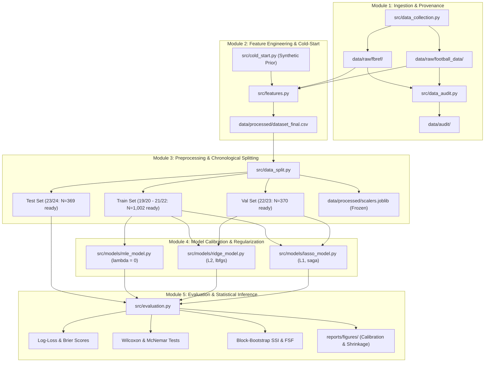

# System Architecture (architecture.md)

**Project:** MLE vs Ridge vs Lasso Logistic Regression for Football Match Outcome Prediction  
**Status:** Operational Blueprint  
**Authority:** [PROJECT_CONSTITUTION.md](file:///d:/MLE-Lasso/PROJECT_CONSTITUTION.md) | [RESEARCH_METHODOLOGY_GUIDE.md](file:///d:/MLE-Lasso/RESEARCH_METHODOLOGY_GUIDE.md#section-g-implementation-blueprint--project-architecture)  

---

## 1. High-Level Modular Architecture

The research codebase is organized into five decoupled, reproducible modules:

---

## 2. Component Responsibilities

1. **`src/data_collection.py`:** Handles network downloads, rate-limiting delays (7s for FBref), and caches raw CSV files. Raw data remains immutable.
2. **`src/data_audit.py`:** Verifies row counts, checks duplicate fixtures, reconciles team names, and audits predictor availability.
3. **`src/features.py`:** Computes rolling $k$-match differential features ($\Delta X = X_{\text{Home}} - X_{\text{Away}}$) strictly using past matches ($j \ge 1$).
4. **`src/cold_start.py`:** Implements synthetic baseline prior protocol for newly promoted clubs using 3-year historical relegation averages.
5. **`src/data_split.py`:** Enforces chronological partitioning (Train: 19/20–21/22, Val: 22/23, Test: 23/24) and freezes training scalers.
6. **`src/models/`:** Encapsulates model calibration:
   - `mle_model.py`: Classical unregularized multinomial logistic regression via statsmodels/scikit-learn.
   - `ridge_model.py`: $L_2$-regularized multinomial logistic regression with L-BFGS solver.
   - `lasso_model.py`: $L_1$-regularized multinomial logistic regression with SAGA solver.
7. **`src/evaluation.py`:** Computes proper scoring rules (Log-Loss, Brier score), ECE, paired Wilcoxon tests, McNemar tests, and bootstrap stability indices.
