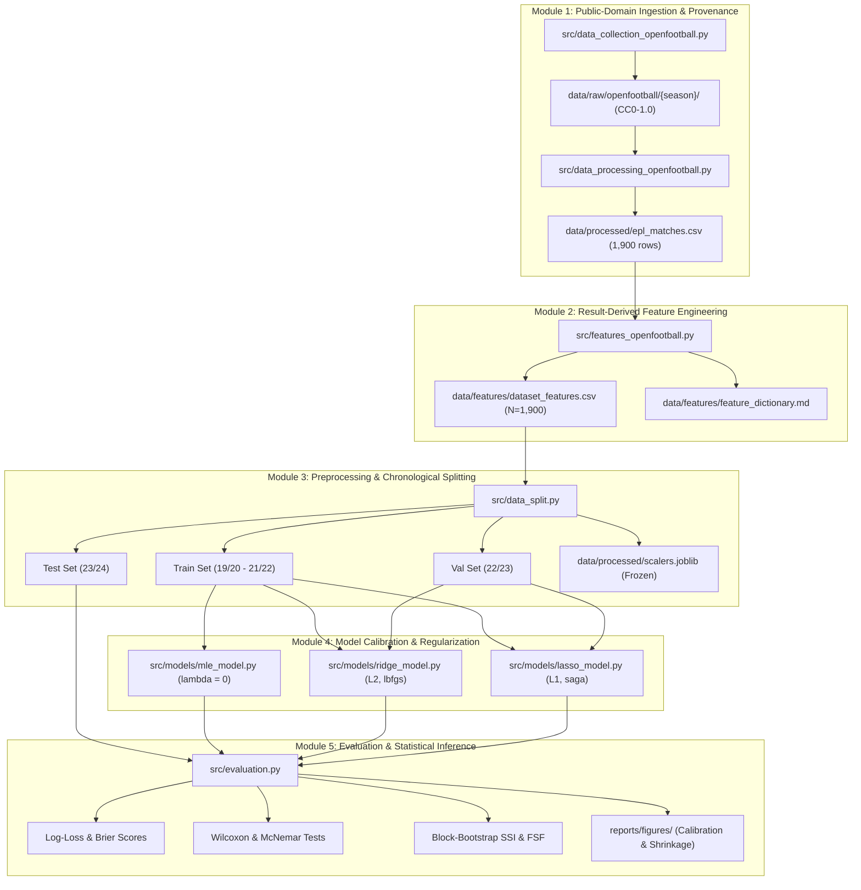

# System Architecture (architecture.md)

**Project:** MLE vs Ridge vs Lasso Logistic Regression for Football Match Outcome Prediction  
**Status:** Operational Blueprint  
**Authority:** [PROJECT_CONSTITUTION.md](file:///d:/MLE-Lasso/PROJECT_CONSTITUTION.md) | [RESEARCH_METHODOLOGY_GUIDE.md](file:///d:/MLE-Lasso/RESEARCH_METHODOLOGY_GUIDE.md#section-g-implementation-blueprint--project-architecture)  

---

## 1. High-Level Modular Architecture

The research codebase is organized into decoupled, reproducible modules operating on public-domain OpenFootball data (ADR-013):

---

## 2. Component Responsibilities

1. **`src/data_collection_openfootball.py`:** Downloads raw Football.TXT files and LICENSE.md from OpenFootball GitHub repository (`https://github.com/openfootball/england`) under CC0-1.0 Public Domain Dedication and records cryptographic SHA-256 hashes.
2. **`src/data_processing_openfootball.py`:** Parses Football.TXT syntax, normalizes club names to 26 canonical EPL entities, derives 3-class targets (`HOME_WIN`, `DRAW`, `AWAY_WIN`), sorts chronologically, and exports `data/processed/epl_matches.csv` (1,900 rows).
3. **`src/features_openfootball.py`:** Computes result-derived rolling $k$-match differential features ($\Delta X = X_{\text{Home}} - X_{\text{Away}}$) strictly using past matches ($j \ge 1$), isolates warm-up fixtures ($N = 159$), and generates `data/features/dataset_features.csv`.
4. **`src/data_split.py`:** Enforces chronological partitioning (Train: 19/20–21/22, Val: 22/23, Test: 23/24) and freezes training scalers.
5. **`src/models/`:** Encapsulates model calibration:
   - `mle_model.py`: Classical unregularized multinomial logistic regression via statsmodels/scikit-learn.
   - `ridge_model.py`: $L_2$-regularized multinomial logistic regression with L-BFGS solver.
   - `lasso_model.py`: $L_1$-regularized multinomial logistic regression with SAGA solver.
6. **`src/evaluation.py`:** Computes proper scoring rules (Log-Loss, Brier score), ECE, paired Wilcoxon tests, McNemar tests, and bootstrap stability indices.

