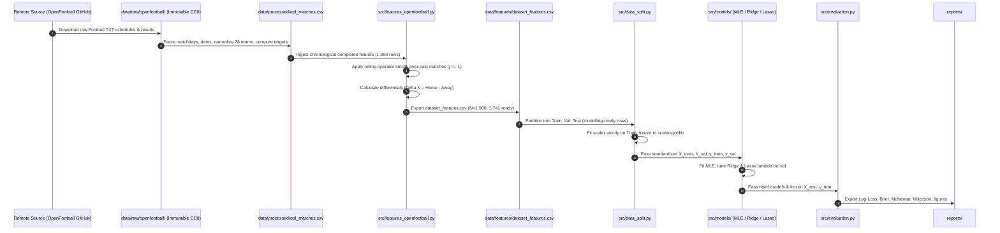

# Dataflow Specification (dataflow.md)

**Project:** MLE vs Ridge vs Lasso Logistic Regression for Football Match Outcome Prediction  
**Status:** Operational Pipeline Flow  
**Authority:** [PROJECT_CONSTITUTION.md](file:///d:/MLE-Lasso/PROJECT_CONSTITUTION.md) | [RESEARCH_METHODOLOGY_GUIDE.md](file:///d:/MLE-Lasso/RESEARCH_METHODOLOGY_GUIDE.md#section-c-dataset-and-feature-engineering-design-fbref)  

---

## 1. End-to-End Pipeline Dataflow

---

## 2. Stage-by-Stage Transformation Contracts

### Stage 1: Public-Domain Raw Ingestion
- **Inputs:** HTTPS GET requests to `https://raw.githubusercontent.com/openfootball/england/master/{season}/1-premierleague.txt`.
- **Outputs:** `data/raw/openfootball/{season}/1-premierleague.txt` (380 matches per season $\times$ 5 = 1,900 matches).
- **Contract:** Immutable raw files under CC0-1.0; SHA-256 hashes recorded in manifest.

### Stage 2: Canonical Match Processing
- **Inputs:** `data/raw/openfootball/` raw seasonal text files.
- **Transformations:**
  1. Parse Football.TXT dates, matchdays, team names, and final scores.
  2. Map 38 raw club string variants to 26 canonical Premier League clubs.
  3. Derive 3-class target: Home Win (2), Draw (1), Away Win (0).
  4. Chronological sorting by date and time.
- **Outputs:** `data/processed/epl_matches.csv` (1,900 rows, 11 columns, 0 nulls).

### Stage 3: Result-Derived Feature Engineering
- **Inputs:** `data/processed/epl_matches.csv`.
- **Transformations:**
  1. Sort all matches strictly chronologically by date and kickoff time.
  2. Compute rolling moving averages strictly over past $k$ fixtures ($j \in [1, k]$): goals scored, goals conceded, points per game, goal difference, venue form, rest days.
  3. Compute symmetrical differentials $\Delta X_t = X_{\text{Home}, t} - X_{\text{Away}, t}$.
  4. Flag warm-up fixtures ($k < 10$ overall or $k < 5$ venue) as `is_modelling_ready = False`.
- **Outputs:** `data/features/dataset_features.csv` (1,900 rows, with `is_modelling_ready` flag and result-derived predictors).
- **Leakage Invariant:** Values for match $t$ must never be modified by events taking place during or after match $t$.

### Stage 4: Chronological Splitting & Preprocessing
- **Inputs:** `data/features/dataset_features.csv` (filtered to `is_modelling_ready == True`).
- **Transformations:**
  1. Chronological partition into Train (`2019/20`–`2021/22`), Val (`2022/23`), Test (`2023/24`).
  2. Fit Z-score standardizers ($z = (x - \mu)/\sigma$) strictly on Train.
  3. Freeze standardizer parameters in `data/processed/scalers.joblib`.
  4. Transform Val and Test using frozen Train parameters.
- **Outputs:** `train.csv`, `val.csv`, `test.csv`.

### Stage 4: Model Calibration & Regularization Tuning
- **Inputs:** Standardized feature matrices and categorical targets.
- **Transformations:**
  1. Unregularized MLE: Solves score equations on Train ($C = \infty$).
  2. Ridge ($L_2$): Grid search $\lambda \in [10^{-4}, 10^4]$ minimizing validation Log-Loss.
  3. Lasso ($L_1$): Coordinate descent / SAGA path minimizing validation Log-Loss.
- **Outputs:** Fitted parameter matrices $\mathbf{B}_{\text{MLE}}, \mathbf{B}_{\text{Ridge}}^*, \mathbf{B}_{\text{Lasso}}^* \in \mathbb{R}^{17 \times 3}$.

### Stage 5: Evaluation & Statistical Hypothesis Testing
- **Inputs:** Fitted models, frozen untouched Test partition (`2023/24`).
- **Transformations:**
  1. Generate predicted probability distributions $\hat{\mathbf{p}}_i \in [0, 1]^3$.
  2. Compute Multi-class Log-Loss, Brier score, Expected Calibration Error.
  3. Execute paired Wilcoxon signed-rank test and McNemar classification test.
  4. Run block-bootstrap resamples ($B = 1,000$) for coefficient standard errors.
- **Outputs:** Summary tables in `reports/` and figures in `reports/figures/`.
