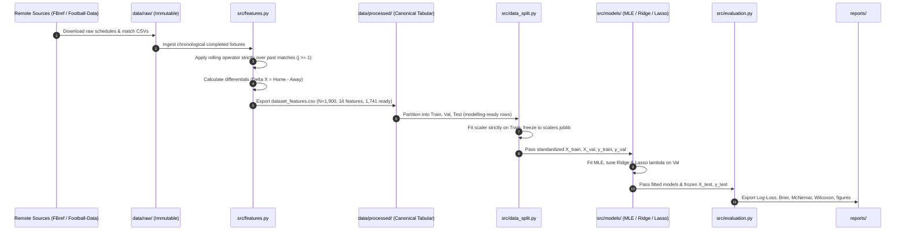

# Dataflow Specification (dataflow.md)

**Project:** MLE vs Ridge vs Lasso Logistic Regression for Football Match Outcome Prediction  
**Status:** Operational Pipeline Flow  
**Authority:** [PROJECT_CONSTITUTION.md](file:///d:/MLE-Lasso/PROJECT_CONSTITUTION.md) | [RESEARCH_METHODOLOGY_GUIDE.md](file:///d:/MLE-Lasso/RESEARCH_METHODOLOGY_GUIDE.md#section-c-dataset-and-feature-engineering-design-fbref)  

---

## 1. End-to-End Pipeline Dataflow

---

## 2. Stage-by-Stage Transformation Contracts

### Stage 1: Raw Ingestion
- **Inputs:** External HTTPS GET requests.
- **Outputs:**
  - `data/raw/fbref/{season}/schedule.csv`: 380 rows $\times$ 16 columns.
  - `data/raw/football_data/premier_league_{season}.csv`: 380 rows $\times$ 106 columns.
- **Contract:** Immutable raw files; exact match counts verified (1,900 total).

### Stage 2: Feature Engineering & Pre-Match Aggregation
- **Inputs:** `data/raw/` fixture schedules and validated match volume logs.
- **Transformations:**
  1. Sort all matches by chronological kickoff timestamp.
  2. Compute rolling moving averages $\bar{X}_t^{(k)}$ strictly over past $k$ fixtures ($j \in [1, k]$).
  3. Apply promoted-team cold-start synthetic baseline prior.
  4. Compute symmetrical differential $\Delta X_t^{(k)} = \bar{X}_{\text{Home}, t}^{(k)} - \bar{X}_{\text{Away}, t}^{(k)}$.
- **Outputs:** `data/features/dataset_features.csv` (1,900 rows with `is_modelling_ready` flag, 16 continuous differential predictors, target labels).
- **Leakage Invariant:** Values for match $t$ must never be modified by events taking place during or after match $t$.

### Stage 3: Chronological Splitting & Preprocessing
- **Inputs:** `data/features/dataset_features.csv` (filtered to `is_modelling_ready == True`, $N = 1,741$).
- **Transformations:**
  1. Chronological partition into Train (`2019/20`–`2021/22`), Val (`2022/23`), Test (`2023/24`).
  2. Fit Z-score standardizers ($z = (x - \mu)/\sigma$) strictly on Train.
  3. Freeze standardizer parameters in `data/processed/scalers.joblib`.
  4. Transform Val and Test using frozen Train parameters.
- **Outputs:** `train.csv`, `val.csv`, `test.csv`.

### Stage 4: Model Calibration & Regularization Tuning
- **Inputs:** Standardized feature matrices and categorical targets.
- **Transformations:**
  1. Unregularized MLE: Solves score equations on Train ($C = \infty$).
  2. Ridge ($L_2$): Grid search $\lambda \in [10^{-4}, 10^4]$ minimizing validation Log-Loss.
  3. Lasso ($L_1$): Coordinate descent / SAGA path minimizing validation Log-Loss.
- **Outputs:** Fitted parameter matrices $\mathbf{B}_{\text{MLE}}, \mathbf{B}_{\text{Ridge}}^*, \mathbf{B}_{\text{Lasso}}^* \in \mathbb{R}^{17 \times 3}$.

### Stage 5: Evaluation & Statistical Hypothesis Testing
- **Inputs:** Fitted models, frozen untouched Test partition (`2023/24`).
- **Transformations:**
  1. Generate predicted probability distributions $\hat{\mathbf{p}}_i \in [0, 1]^3$.
  2. Compute Multi-class Log-Loss, Brier score, Expected Calibration Error.
  3. Execute paired Wilcoxon signed-rank test and McNemar classification test.
  4. Run block-bootstrap resamples ($B = 1,000$) for coefficient standard errors.
- **Outputs:** Summary tables in `reports/` and figures in `reports/figures/`.
