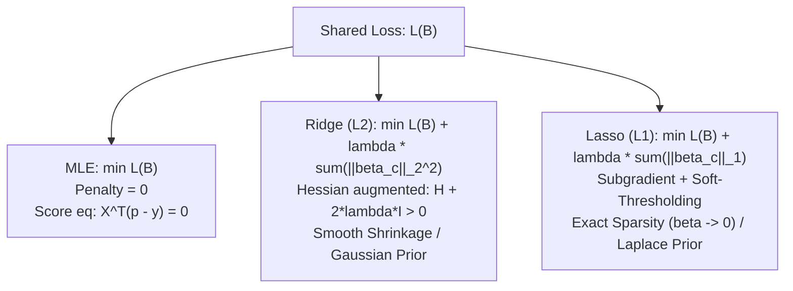

# Mathematical Logic & Regularization Formulation (mathlogic.md)

**Project:** MLE vs Ridge vs Lasso Logistic Regression for Football Match Outcome Prediction  
**Status:** Mathematical Reference Specification  
**Authority:** [PROJECT_CONSTITUTION.md](file:///d:/MLE-Lasso/PROJECT_CONSTITUTION.md) | [RESEARCH_METHODOLOGY_GUIDE.md](file:///d:/MLE-Lasso/RESEARCH_METHODOLOGY_GUIDE.md#section-d-mathematical-foundations-mle-vs-ridge-vs-lasso)  

---

## 1. Multinomial Logistic Model Formulation

For match $i \in \{1, \dots, n\}$, let $\mathbf{x}_i = [1, \Delta X_{i, 1}, \dots, \Delta X_{i, p}]^T \in \mathbb{R}^{p+1}$ denote the vector of $p = 16$ pre-match standardized differentials augmented with an intercept. The outcome space comprises $K = 3$ mutually exclusive classes:
$$\mathcal{Y} \in \{c_1: \text{Away Win}, \; c_2: \text{Draw}, \; c_3: \text{Home Win}\}$$

The probability of outcome $c$ is specified by the **Symmetric Softmax Link**:
$$p_{ic} = P(y_i = c \mid \mathbf{x}_i; \mathbf{B}) = \frac{\exp(\mathbf{x}_i^T \boldsymbol{\beta}_c)}{\sum_{r=1}^{K} \exp(\mathbf{x}_i^T \boldsymbol{\beta}_r)}$$
where $\mathbf{B} = [\boldsymbol{\beta}_1, \boldsymbol{\beta}_2, \boldsymbol{\beta}_3] \in \mathbb{R}^{(p+1) \times 3}$.

---

## 2. Shared Negative Log-Likelihood (Categorical Cross-Entropy) Loss

Let $y_{ic} \in \{0, 1\}$ be the one-hot encoded ground truth. The unregularized empirical risk function $\mathcal{L}(\mathbf{B})$ is:
$$\mathcal{L}(\mathbf{B}) = -\frac{1}{n} \sum_{i=1}^{n} \sum_{c=1}^{K} y_{ic} \ln(p_{ic}) = -\frac{1}{n} \sum_{i=1}^{n} \left[ \sum_{c=1}^{K} y_{ic} \mathbf{x}_i^T \boldsymbol{\beta}_c - \ln\left( \sum_{r=1}^{K} \exp(\mathbf{x}_i^T \boldsymbol{\beta}_r) \right) \right]$$

### Gradient & Hessian Under Collinearity
$$\nabla_{\boldsymbol{\beta}_c} \mathcal{L}(\mathbf{B}) = \frac{1}{n} \sum_{i=1}^{n} (p_{ic} - y_{ic}) \mathbf{x}_i = \frac{1}{n} \mathbf{X}^T (\mathbf{p}_c - \mathbf{y}_c)$$
$$\mathbf{H}_{cc} = \nabla_{\boldsymbol{\beta}_c}^2 \mathcal{L}(\mathbf{B}) = \frac{1}{n} \sum_{i=1}^{n} p_{ic}(1 - p_{ic}) \mathbf{x}_i \mathbf{x}_i^T = \frac{1}{n} \mathbf{X}^T \mathbf{W}_c \mathbf{X}$$

When covariates are highly collinear ($\text{VIF} > 5$), $\mathbf{X}^T \mathbf{X}$ develops near-zero eigenvalues, causing $\mathbf{H}^{-1}$ to explode, inflating coefficient variance $\operatorname{Var}(\hat{\boldsymbol{\beta}}) = \mathbf{H}^{-1}$.

---

## 3. Regularization Penalties Compared

### 1. Unregularized MLE ($\lambda = 0$)
- **Objective:** $\min_{\mathbf{B}} \mathcal{L}(\mathbf{B})$
- **Property:** Asymptotically unbiased under classical assumptions, but exhibits extreme parameter instability and sign flips under severe collinearity.

### 2. Ridge Regularization ($L_2$ Penalty)
- **Objective:** $\min_{\mathbf{B}} \mathcal{L}(\mathbf{B}) + \lambda \sum_{c=1}^{K} \sum_{j=1}^{p} \beta_{jc}^2$
- **Hessian Modification:** $\mathbf{H}_{\text{Ridge}} = \frac{1}{n} \mathbf{X}^T \mathbf{W} \mathbf{X} + 2\lambda \mathbf{I}$.
- **Mechanism:** Uniform smooth shrinkage toward zero. Guaranteed strictly positive definite Hessian ($\mathbf{H} \succ 0$), stabilizing numerical inversion and reducing variance at the cost of slight bias. Intercepts $\beta_{0, c}$ are strictly unpenalized.

### 3. Lasso Regularization ($L_1$ Penalty)
- **Objective:** $\min_{\mathbf{B}} \mathcal{L}(\mathbf{B}) + \lambda \sum_{c=1}^{K} \sum_{j=1}^{p} |\beta_{jc}|$
- **Mechanism:** Non-differentiable sharp corner at $\beta = 0$. Utilizes proximal gradient / soft-thresholding operator $\mathcal{S}_{\lambda \eta}$:
  $$\mathcal{S}_{\alpha}(u) = \operatorname{sign}(u) \max(|u| - \alpha, 0)$$
  Drives redundant, collinear covariates exactly to zero, performing simultaneous estimation and variable selection. Intercepts $\beta_{0, c}$ are strictly unpenalized.

---

## 4. Full Theoretical Derivations

For comprehensive mathematical proofs, Hessian condition number bounds, soft-thresholding derivations, and Bayesian MAP interpretations (Gaussian vs. Laplace priors), refer to [Section D of RESEARCH_METHODOLOGY_GUIDE.md](file:///d:/MLE-Lasso/RESEARCH_METHODOLOGY_GUIDE.md#section-d-mathematical-foundations-mle-vs-ridge-vs-lasso).
